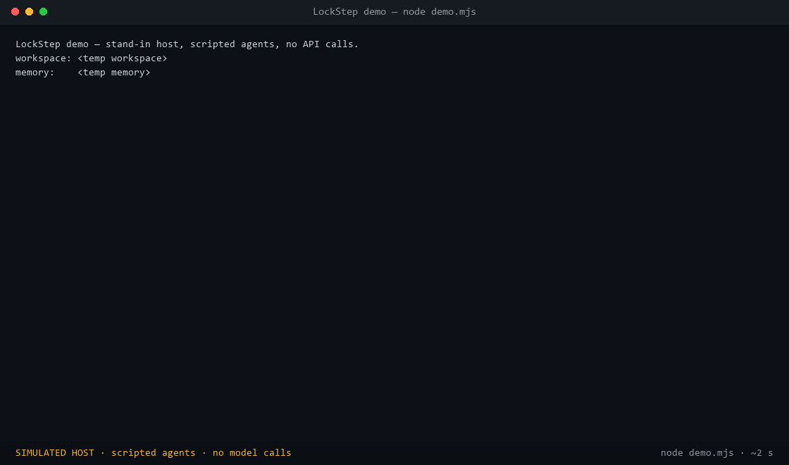

<div align="center">

# ⚡ LockStep & Two Smoking LLMs

### Guardrails for DeepSeek Harness agent swarms

**Two zero-dependency plugins: strict, disk-verified task reports and turn-boundary model fallback.**



[](#what-is-tested-and-what-is-not)
[](#compatibility)
[](#compatibility)
[](#requirements)
[](LICENSE)

</div>

> **Status: pre-release.** Version `0.1.0`, not published to npm, no tagged release, no release PR open. `main` is the install target; the steps below build from source. Live checks are listed under [what is not tested](#what-is-tested-and-what-is-not).

## The problem

A multi-agent swarm looks fine in a single-turn demo and then fails in the ways that cost you the run:

| What goes wrong | What LockStep does about it |
|---|---|
| 🎭 **A Worker says `done` with a criterion it skipped.** | The report is saved as `partial`, the unmet criterion is named, and the miss is logged as a lesson. |
| 💬 **A Worker claims a file says `1.4.1`; the file says `1.4.0`.** | The claim carries a `check` (`exists`, `equals`, `contains`, `size`, `sha256`, `hex`). The plugin reads the real file and reports `first difference at byte 4: the file has 30, you claimed 31`. The claim is recorded as not met and the report drops to `partial`. |
| ✅ **A Verifier says `PASS`, but the file changed after the Worker reported.** | At verdict time the Worker's file claims are re-checked on disk. The `PASS` is recorded as `FAIL` and its playbook is retired instead of poisoning later runs. |
| 💥 **Parallel writes collide on Windows file locks / OneDrive.** | High-entropy temp names, exponential backoff and crash-safe rename. In the stress run, 0 of 500 parallel writes were lost (see [the numbers](#the-numbers)). |
| 🔁 **One provider outage burns every agent's retry loop.** | Fleet outage memory: the step that hits the outage still fails, then the next turn starts on the backup model, and other agents switch at their next step boundary instead of each burning the same failed retries. The switch only happens at a step boundary, because DeepSeek fixes the model during step preparation. |
| 🧠 **One `read_task_report` dumps 300k tokens into the Manager.** | Reports are capped at 2,000 characters (~500 tokens); playbook search returns names and step counts, not full text. |

## Compatibility

Check your harness version first:

```bash
dsh --version
```

| DeepSeek Harness | `verdent-report` | `model-fallback` |
|---|---|---|
| **0.2.2-alpha.2 and newer** (checked: 0.2.2-alpha.2, 0.2.2-alpha.3, 0.2.2-rc.1) | works | active: uses `agent.model.select()` |
| **0.2.1-rc.x** (checked: rc.3, rc.5) | works | **stays off**: loads, logs one warning (`needs 0.2.2-alpha.2 or newer`), never switches. There is a test for this. |
| Older / unknown | not tested | not tested |

`agent.model.select()` was added in the 0.2.2 line. This repo's tests check that fallback disables itself cleanly on 0.2.1-rc.x instead of crashing. If you only need verified reports, 0.2.1-rc.3 is enough today.

## Quick start

### Requirements

- **Node.js ≥ 22.13** (tested on Node 26)
- **DeepSeek Harness ≥ 0.2.1-rc.3** for `verdent-report`; **≥ 0.2.2-alpha.2** for `model-fallback`
- Nothing else: both plugins have zero npm dependencies.

### 1. Build and run the checks

```bash
git clone https://github.com/jlew23/LockStep-and-Two-smoking-LLMs.git
cd LockStep-and-Two-smoking-LLMs
node build.mjs
node test.mjs
```

Expected: **41 passing** — 25 unit tests, 16 integration tests (11 smoke + 5 evidence-check) on the stand-in host. If you don't see `pass 25` and `pass 16`, stop here and open an issue with the failing output.

### 2. Watch the demo

```bash
node demo.mjs
```

About two seconds, no Harness and no API key. It runs four scripted scenes on the stand-in host: a false file claim being caught, a playbook being saved, a `PASS` being reversed when the file changes, and a provider outage moving the fleet to the backup model. The GIF at the top of this page is a recording of this command (regenerate it with `python docs/make-demo-gif.py`, which needs Pillow). The host is simulated and the agents are scripted — it is **not** live footage.

### 3. Install the plugins into a profile

The packages are not on npm, so install them from your clone:

```bash
dsh plugin --profile <your-profile> add "file:D:/code/LockStep-and-Two-smoking-LLMs/verdent-report"
dsh plugin --profile <your-profile> add "file:D:/code/LockStep-and-Two-smoking-LLMs/model-fallback"
```

(Use the path to your clone; on macOS/Linux the same `file:` form works.)

Then add the mounts to that profile's `cordis.patch.yml`. `memoryDir` must be a **full path** — the plugin does not expand `~`.

<details open>
<summary><b>Per-preset report plugin</b> (one mount per role)</summary>

```yaml
# Manager preset
- id: verdent-report
  name: '@jarvis/dsh-verdent-report'
  config:
    memoryDir: '<memoryDir>'
    role: manager

# Worker preset
- id: verdent-report
  name: '@jarvis/dsh-verdent-report'
  config:
    memoryDir: '<memoryDir>'
    role: worker
    requireReportPresets: [worker-verdent]

# Verifier preset
- id: verdent-report
  name: '@jarvis/dsh-verdent-report'
  config:
    memoryDir: '<memoryDir>'
    role: verifier
    requireReportPresets: [verifier-verdent]
```

</details>

<details>
<summary><b>Global fallback plugin</b> (needs 0.2.2-alpha.2+)</summary>

```yaml
- insert:
    - id: model-fallback
      name: '@jarvis/dsh-model-fallback'
      config:
        chains:
          deepseek-v4-pro: [deepseek-flash]
          deepseek-flash: [deepseek-v4-pro]
        cooldownMs: 300000   # 5 minutes of outage memory
```

</details>

Not sure which shape you need? [`presets/README.md`](presets/README.md) has six ready-made setups (Solo, Team, Team cheap, Strict, Overnight, Test bench) with measured per-request token costs.

### 4. Verify it worked

1. Start the profile (`dsh --profile <your-profile>`).
2. Give an agent a task with one file claim you know is false, for example: *"Report `task_id: smoke-1`, `status: done`, one criterion `README says hello`, with a check `equals` on `README.md` and text `hello`."*
3. The reply should say `partial`, name the failed check, and the report should appear under `<memoryDir>/reports/`. If it says `done`, the plugin is not mounted on that agent.

On 0.2.1-rc.x you will also see one `model-fallback` warning in the log. That is expected, not a broken install.

### 5. Add the prompt directives

These short lines get the most out of the guardrails:

| Role | Directive |
|---|---|
| **Manager** | Start tasks with `task_id: <unique_id>` and 3–7 verifiable criteria. Call `find_playbooks_v1` and `recent_lessons_v1` before planning. Read results via `read_task_report_v1`. |
| **Worker** | Read referenced guides with `read_playbook_v1`. Keep the criteria in your active checklist. Submit via `submit_worker_report_v1` with concrete evidence, and add `checks` (`exists`, `equals`, `contains`, `size`, `sha256`, `hex`) for every claim about a file. |
| **Verifier** | Check every criterion. Grade all items with `submit_verdict_v1`, using `checks` where you can. |

## What is tested and what is not

Everything below was run on the author's Windows machine in October–November 2026. The test suite uses a stand-in host (`tests/fake-host.mjs`) built to mirror DeepSeek Harness's hook order, duplicate-tool rules and model-selection semantics; it is not the real host.

| Tested | How |
|---|---|
| `done` with unmet criteria is saved as `partial`, not refused | unit + integration tests |
| A `PASS` that skips a Worker criterion saves no playbook; a later `FAIL` retires it | integration tests |
| File claims (`exists`, `equals`, `contains`, `size`, `sha256`, `hex`) are checked against the real disk; a wrong claim flips `done` → `partial` | integration tests |
| A `PASS` is re-checked at grading time and recorded as `FAIL` if a claim no longer holds | integration test |
| Paths outside the workspace are refused and never read; an unknown workspace fails closed | integration test |
| 20 parallel reports for one task: no rejected writes, every lesson kept | integration test |
| Fallback switches at the next step, shares outage memory across agents, restores after cooldown, and disables itself on 0.2.1-rc.x | unit + integration tests |

| Not tested yet | Status |
|---|---|
| Fallback during a **real provider outage** on a live swarm | no published logs; the demo simulates the outage |
| **DeepSeek Harness 0.2.2-alpha.2+** with these plugins | API verified in the published package; live run not recorded |
| **Linux and macOS** | developed and tested on Windows only |
| **Long-running swarms / large repos** | the stress numbers below came from one machine, not a public harness |
| Playbook quality after months of use | no longitudinal data |

## The numbers

These are from `FINDINGS.md`: **426 stress runs**, **~2.6M tokens**, **5 parallel tester agents**, **3 review panels**, 117 cataloged issues.

| Failure vector | Unprotected baseline | With LockStep | Change |
|---|---|---|---|
| Manager context per report | up to **316,000** tokens | ≤ **500** tokens (≤ 2,000 chars) | **-99.84%** |
| Playbook search blast | ~13,000 tokens (raw file dumps) | ~150 tokens (metadata only) | **-98.8%** |
| Tool error payloads | up to **1,000,000** chars echoed | ≤ **250** chars | **-99.97%** |
| Parallel task writes | **457 / 500 failed** (91.4%) | **0 / 500** failed | 100% write reliability |
| Institutional memory | **184 / 200** lessons lost | **0 / 200** lost | zero knowledge loss |
| Provider 429/500 cascade | 15 wasted retries across 5 agents | the first step still fails; later turns start on the backup | no retry storm for the rest of the fleet |
| Mid-step model switch | fatal host crash | turn-boundary recovery | switches only between turns |
| Playbook search (1k files) | unindexed disk re-read | 24 ms warm / 237 ms cold | sub-second lookup |

Read the baseline column carefully:

- **It is not stock DeepSeek Harness.** It is the first version of these plugins under the stress tests, before atomic writes, output caps and disk checks were added. The improvement is real, but it is "early build vs hardened build", not "no plugins vs plugins".
- **"0 wasted retries" overstates it.** The agent whose step hits the outage still uses that step's retries; only the other agents skip theirs. That is the behavior the demo shows.
- **The raw logs are not in this repo.** The numbers are the author's measurements from one Windows machine; treat them as a starting point, not a published benchmark.

## Benchmark (runner only, no results yet)

`benchmark/` contains a head-to-head runner: Claude Code vs clean DeepSeek Harness vs DeepSeek Harness + LockStep, nine script-graded tasks, with a free `node benchmark/validate.mjs` that proves each grader works on fake contenders. **No results are committed yet** — running it costs API credit. Please don't quote a comparison until it has been run and the report is in `benchmark/results/`. See [`benchmark/README.md`](benchmark/README.md).

## How it works

### 1. Record, don't refuse

A slightly oversized or malformed report is trimmed and recorded instead of rejected and re-sent, so the model doesn't pay to rewrite 2,000 tokens. Only fatal schema breaks are refused, and with a one-line fix the agent can act on.

### 2. Atomic, crash-proof persistence

High-entropy temp names, exponential backoff and inverted write order: lessons go to disk before the report is finalized, so they survive a process that dies mid-task.

### 3. Fleet outage memory

```
agent 1 ─► 429 from deepseek-v4-pro ─► outage recorded (5 min cooldown)
agent 2 ─► next turn ─► sees the outage ─► runs on deepseek-flash  (no wasted call)
agent 3 ─► next turn ─► sees the outage ─► runs on deepseek-flash
```

The switch happens only at a step boundary (the start of a step, or the end of a turn). DeepSeek fixes the model during step preparation, so swapping mid-step crashes the host.

### 4. Verified playbooks only

A playbook is saved only when a Verifier passes **100%** of the Worker's criteria. Any later `FAIL` moves it to `playbooks/.retired/`, so a bad step never reaches the library.

### 5. Check, don't trust

A schema proves a report is filled in, not that it is true. For any claim about a file the agent attaches `checks`, and the plugin verifies them against the real disk: `exists`, `equals`, `contains`, `size`, `sha256`, `hex`. Wrong claims are recorded as not met and logged as lessons. Claims without checks are accepted but marked unverified; set `requireChecks: true` to record them as not met. This cannot verify claims that aren't about files ("the tests pass"), and paths outside the session workspace are refused.

## Where it came from

The plugins were shaped by a swarm stress-test project: 426 runs, ~2.6M tokens, 117 triaged issues, then multi-day live runs on Windows. `FINDINGS.md` documents the methodology, post-mortems and issue index. The design borrows ideas from other agent runtimes the author studied, but the only reproducible evidence in this repo is the test suite and the findings report.

## Try it on one real task

If you use DeepSeek Harness agents for real work, install `verdent-report`, give one task a file claim you can check, and tell me where setup or output is confusing. A concrete report is more useful than a star.

**[→ Open a "tried it" report](https://github.com/jlew23/LockStep-and-Two-smoking-LLMs/issues/new?template=try-report.md)** — the template asks for your `dsh --version`, OS and the exact reply you got.

## Repo layout

```
verdent-report/   strict reports, disk checks, stop check, lessons log, playbook library
model-fallback/   turn-boundary failover + fleet outage memory
presets/          six ready-made configs with measured costs
tests/            stand-in DeepSeek host + smoke and evidence-check tests
demo.mjs          the runnable demo; docs/demo.gif is a recording of it
docs/             demo.gif + the script that regenerates it
launch-kit.md     community/Show HN drafts, pre-launch checklist, tracking table
benchmark/        head-to-head runner (no committed results yet)
FINDINGS.md       stress-test report
```

## License

[MIT](LICENSE)

<div align="center">
<br>
<sub>If LockStep saved your swarm from itself, a ⭐ helps other people find it.</sub>
</div>
